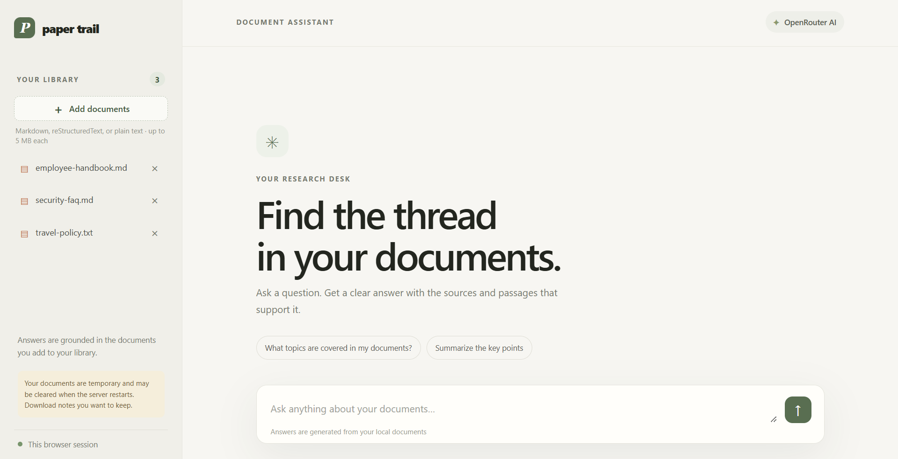

# Paper Trail FAQ Agent

A small browser-based FAQ assistant that searches local documents, asks an
OpenRouter model to answer using matching passages, and reports the source
files. It can also preview and save an answer as a Markdown note after
confirmation.

## Try it online

The app is deployed on Render: <https://paper-trail-l109.onrender.com/>.
Documents and notes in the deployed app are temporary and may be cleared when
the service restarts or redeploys. Download any notes you want to keep.



## Requirements

- Python 3.10 or later
- An OpenRouter API key
- Internet access when asking questions; matching document passages are sent to
  OpenRouter to generate an answer
- Packages in `requirements.txt`

Install the web server dependencies from the project directory:

```powershell
python -m pip install -r requirements.txt
```

## Set up the API key

The agent reads the key from the `OPEN_ROUTER_API_KEY` environment variable.
Do not put the key in this README or commit it to source control.

In PowerShell, set it for the current terminal session:

```powershell
$env:OPEN_ROUTER_API_KEY = "your-openrouter-key"
```

To store it for future Windows terminal sessions, use `setx` and open a new
terminal afterward:

```powershell
setx OPEN_ROUTER_API_KEY "your-openrouter-key"
```

## Run

From the project directory, start the FastAPI server:

```powershell
python -m uvicorn web_app:app --reload
```

Open <http://127.0.0.1:8000> in your browser. The browser UI replaces the
interactive CLI as the primary interface. The old CLI remains available with
`python .\faq_agent.py`.

The web app stores each browser session separately under
`data/sessions/<session-id>/documents` and `data/sessions/<session-id>/notes`.
It seeds each new session with the three sample documents in `documents/`.
Uploaded `.md`, `.rst`, and `.txt` files must be UTF-8 text and are limited to
5 MB each, 50 supported documents per session, and 25 MB total document storage
per session. The sample documents count toward those limits. Confirmed notes are
limited to 100 files and 5 MB total per session.

Session cookies are HttpOnly and SameSite=Lax. They identify a browser session,
not a user account. Treat the cookie as a bearer token: anyone who obtains it
may access that browser session. The session is created on the first API request
(not for the homepage, static assets, or `/healthz`). At most 300 active
session directories are allowed per app instance; new session requests receive
HTTP 503 when the cap is reached. Idle sessions are removed after three hours
by default. Override the timeout and local data root with:

The API also applies an in-memory sliding-window limit of 10 requests per
minute per session and per client IP. When deployed behind a proxy, configure
the proxy to overwrite or sanitize `X-Forwarded-For`; the app uses its first IP
address as the client IP. Excess requests receive HTTP 429 and a `Retry-After`
header. These limits are per app instance.

```powershell
$env:FAQ_SESSION_IDLE_HOURS = "3"
$env:FAQ_DATA_DIR = ".\data"
$env:FAQ_COOKIE_SECURE = "true"
$env:OPENROUTER_MODEL = "liquid/lfm-3-1.7b:free"
python -m uvicorn web_app:app --reload
```

Set `FAQ_COOKIE_SECURE=true` in the Render environment because the deployed app
uses HTTPS. Confirm the browser session cookie includes the `Secure` attribute
after deployment. Leave this variable unset for local HTTP development.

When running locally, uploaded documents and notes are stored on your computer
under the configured data directory. When hosted on Render, they are stored on
the server in separate per-browser-session folders. Those files are not stored
on the visitor's computer, and the session cookie is not a user account or a
login. The hosted data directory is instance-local and ephemeral: documents and
notes can disappear when the service restarts or redeploys. The UI displays
this warning, and users should download any notes they want to keep. Matching
passages from documents are sent to OpenRouter when a question is answered in
both local and hosted use.

The browser displays the answer, numbered source files, retrieved passages,
any citation-number warnings, and an **Actions taken** trace with each action's
status, feedback, and execution time. The API also reports planning and total
request timings. Use **Save answer as a note** to preview a note; it is written
only after selecting **Save note** in the confirmation dialog.
In the browser app, uploads and notes are stored in the current session's
folders, not in the repository's `documents/` and `notes/` directories. After a
note is saved, use the **Download note** link in the confirmation dialog to
download the Markdown file before the session or server is cleared.

## Add your own documents

Place text-based `.md`, `.rst`, or `.txt` files in `documents` (or the folder
passed with `--documents`). Subdirectories are searched too. The three
documents seeded into browser sessions are fictional examples for trying out
the agent. The repository's `.gitignore` excludes other files in `documents/`,
including your uploaded documents, and excludes generated notes. This helps
prevent publishing private document content when pushing the project.

The ignore rules also cover environment files and common credential files.
They do not remove secrets that were already committed or staged; check your
Git status and history before publishing, and rotate any credential that may
have been exposed.

Search currently scores paragraphs by matching query terms. Only the matching
passages are sent to OpenRouter, with instructions to rely on those passages and
cite the supporting source files together in one bracket when multiple files
support the claim. If no passages match, the agent reports that it could not find
relevant evidence rather than asking the model to answer without sources.

## DSL commands

The agent asks the model for a small action plan using these commands:

```text
SEARCH(query[, max_results])
ANSWER(question, passages)
SAVE_NOTE(title, content, sources)
LIST_DOCS()
```

- `SEARCH` returns matching local passages with source filenames. `max_results`
  is optional and defaults to 5.
- `ANSWER` asks the model to answer using the supplied passages. In an FAQ plan,
  use the special `$SEARCH_RESULTS` value for `passages`; the agent replaces it
  with the results from the preceding `SEARCH`.
- `SAVE_NOTE` previews a note and saves it only after the user confirms. Both
  the browser and terminal interfaces offer to save an answer after displaying it.
- `LIST_DOCS` lists available supported documents.

The FAQ agent parses the model output as command syntax, checks that commands
are supported and arguments are literal values, and rejects executable Python
and argument unpacking. Supported named arguments are normalized to the
commands' positional order. A valid FAQ plan must include `SEARCH` and
`ANSWER`. The agent then executes the plan in order, passes search results to
`ANSWER`, checks that answer citation numbers map to the supplied source files,
and shows both the answer and retrieved passages. The DSL executor performs the
local search and note writing; note writing requires an explicit confirmation.

The HTTP interface provides `GET`, `POST`, and `DELETE /api/documents`,
`POST /api/ask`, and `POST /api/notes`. Deleting a document returns `204 No
Content` with an empty body. The browser only communicates with this same-origin
API; the OpenRouter key remains on the server and is read from
`OPEN_ROUTER_API_KEY`.

## Audit logging

The app writes structured JSON Lines events to both stdout and
`logs/audit.jsonl` by default. Stdout makes events available in Render's log
stream when the instance-local filesystem is unavailable or reset. Set
`FAQ_AUDIT_LOG` to change the file path. HTTP requests (including failures), FAQ
asks, DSL command execution, and note save/confirmation outcomes are recorded
with UTC timestamps and status metadata. Each event includes a request ID and a
SHA-256 hash of the session ID when the session is known, so events from one
request and session can be correlated without logging the session cookie.
These hashes are stable pseudonymous identifiers, not anonymized data. The log
intentionally excludes API keys, prompts, questions, answers, and document
contents. Audit logs are excluded from Git by `.gitignore`.

## Run the tests

```powershell
python -m pip install httpx2
python -m unittest discover -s tests -v
```

`httpx2` is needed by Starlette's `TestClient` for the web API tests; it is not
needed to run the application itself.
